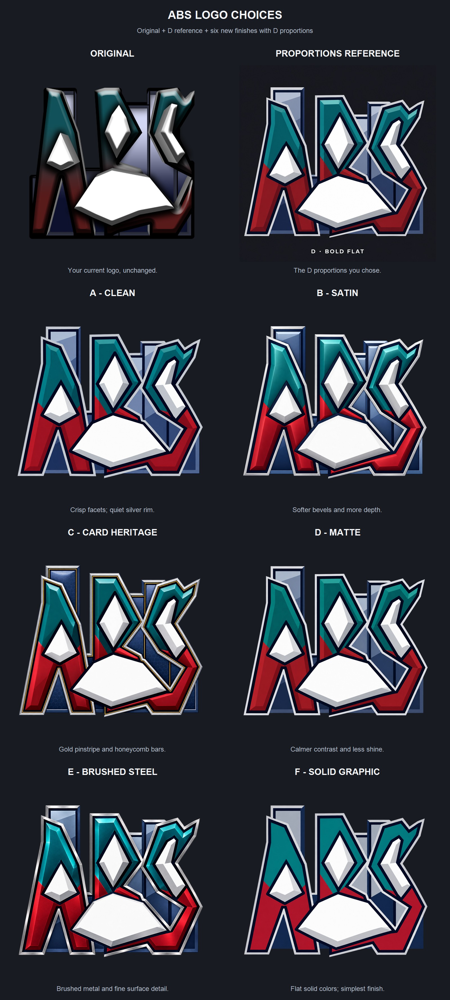
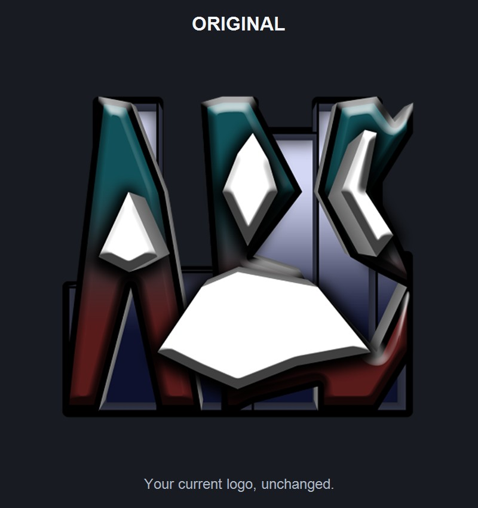
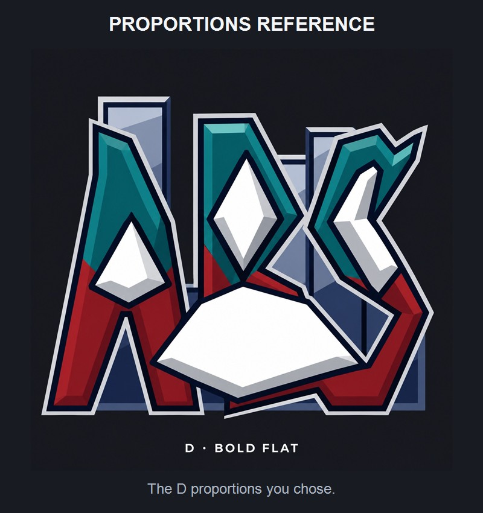
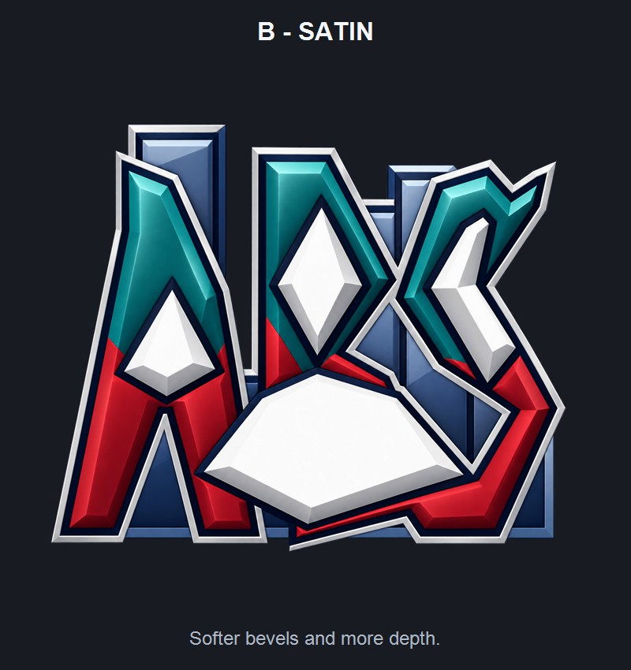
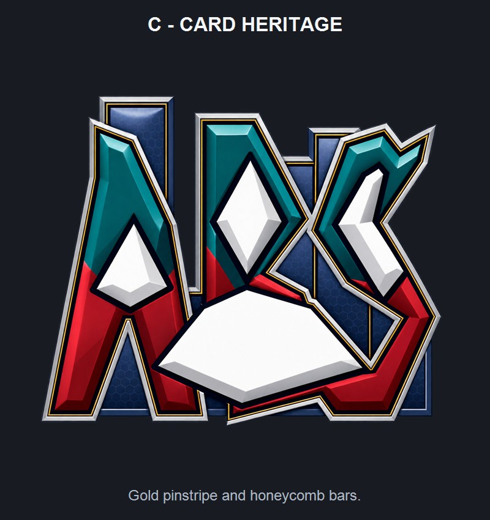
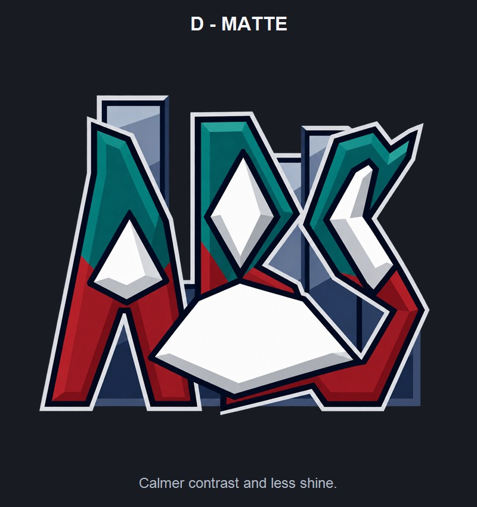
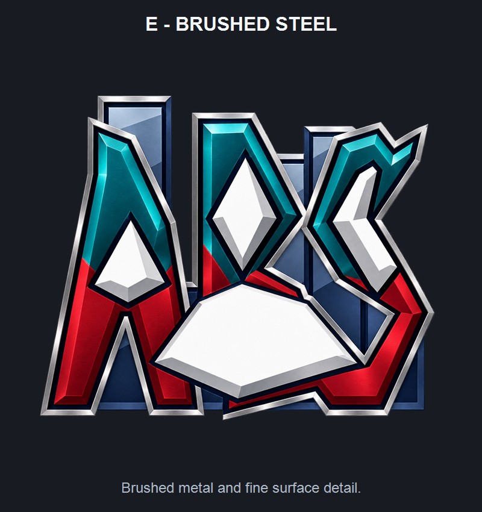
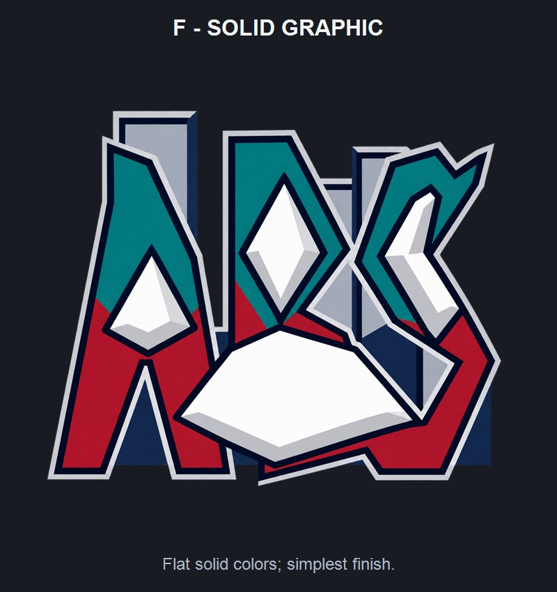

# ABS logo choices

The original is included for reference. Options A-F all use the broader proportions from D, with different finishes. These are draft logo concepts for selection.

[Open the full comparison image](all-options.jpg)

## ORIGINAL

Your current logo, unchanged.

[Open large preview](original-preview.jpg) | [Open original file](original.png)

## PROPORTIONS REFERENCE

The D proportions you chose.

[Open large preview](d-reference-preview.jpg) | [Open original file](d-reference.jpg)

## A - CLEAN

Crisp facets; quiet silver rim.

[Open large preview](option-a-preview.jpg) | [Open original file](option-a.png)

## B - SATIN

Softer bevels and more depth.

[Open large preview](option-b-preview.jpg) | [Open original file](option-b.png)

## C - CARD HERITAGE

Gold pinstripe and honeycomb bars.

[Open large preview](option-c-preview.jpg) | [Open original file](option-c.png)

## D - MATTE

Calmer contrast and less shine.

[Open large preview](option-d-preview.jpg) | [Open original file](option-d.png)

## E - BRUSHED STEEL

Brushed metal and fine surface detail.

[Open large preview](option-e-preview.jpg) | [Open original file](option-e.png)

## F - SOLID GRAPHIC

Flat solid colors; simplest finish.

[Open large preview](option-f-preview.jpg) | [Open original file](option-f.png)

